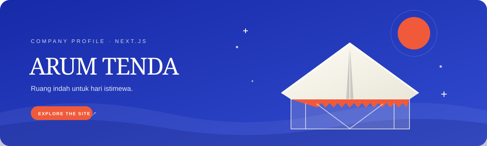

<p align="center">
  
</p>

<p align="center">
  
  
  
</p>

<p align="center"><b>Company profile dan katalog penyewaan tenda.</b><br>Frontend prototipe Arum Tenda, sedang dalam migrasi dari Vite ke Next.js.</p>

##  Tentang proyek

Arum Tenda membantu calon pelanggan menjelajahi layanan, melihat katalog dan galeri, mencoba simulasi warna tenda, lalu menghubungi bisnis melalui WhatsApp. Versi Next.js menjadi aplikasi utama yang sedang disiapkan; versi Vite tetap tersedia sebagai pembanding selama migrasi.

##  Halaman

| Rute | Isi |
| --- | --- |
| `/` | Beranda dan pengenalan layanan |
| `/tentang` | Profil Arum Tenda |
| `/katalog` | Pilihan tenda dan perlengkapan |
| `/galeri` | Inspirasi dekorasi acara |
| `/simulasi` | Pratinjau jenis dan warna tenda |
| `/kontak` | Informasi dan jalur kontak |

##  Jalankan aplikasi

**Next.js** — jalur migrasi utama:

```powershell
npm.cmd install
npm.cmd run dev
```

Buka <http://localhost:3000>. Untuk membuat build dan menjalankan server production lokal:

```powershell
npm.cmd run build
npm.cmd start
```

**Vite** — versi pembanding:

```powershell
npm.cmd run vite:dev
```

Gunakan alamat yang dicetak Vite (biasanya <http://localhost:5173>). Perintah `npm.cmd run vite:build` dan `npm.cmd run vite:preview` tersedia untuk build dan pratinjau versi lama.

##  Struktur proyek

```text
app/          Rute Next.js dan komponen halaman
styles/       CSS bersama untuk Next.js dan Vite
shared/       Kode browser bersama, termasuk latar Satin
legacy-vite/  Sumber Vite lama dan helper untuk menjalankannya
docs/         Aset dokumentasi proyek
```

##  Fitur prototipe

- Katalog dengan filter kategori, detail produk, jumlah pesanan, dan tautan WhatsApp.
- Pengelolaan katalog di browser: tambah, ubah, dan hapus data.
- Galeri dengan filter dan transisi GSAP Flip.
- Simulasi jenis tenda dan pilihan warna.
- Navigasi responsif dan latar Satin.

Perubahan katalog tersimpan di `localStorage` browser ini menggunakan kunci `arum-tenda-catalog-v1` dan `arum-tenda-equipment-seeded-v1`. Data tersebut belum dibagikan antarperangkat atau terhubung ke backend.

##  Sebelum digunakan sungguhan

Nomor WhatsApp `6281234567890`, harga katalog, foto Unsplash, dan konten galeri masih berupa contoh. Perbarui data bisnis sebelum dipakai untuk menerima pesanan. Google Fonts, Bootstrap Icons, foto Unsplash, dan dependensi shader Satin memerlukan koneksi internet.

Proyek saat ini menggunakan server Next.js. Target hosting dan konfigurasi ekspor statis belum ditentukan.
